<div align="center">


# LightLib

**일본 라이트노벨을 위한 안드로이드·웹 전자책 서재·리더 <br/> 책 본래의 조판 그대로, 읽으면서 번역하고, 어디까지 읽었는지 기억합니다.**

[English](README.md) | **한국어**

[](https://flutter.dev/)
[](https://www.gnu.org/licenses/agpl-3.0.html)
[](https://github.com/4rNe5/LightLib/releases/latest)

[](https://github.com/4rNe5/LightLib/releases/latest)

**[📖 자주 묻는 질문](./FAQ.ko.md)**
</div>

## 기능 ✨

### 읽기
- **책을 만든 그대로 보여주는 리더** — [foliate-js](https://github.com/johnfactotum/foliate-js) 기반. 책 본래의 조판·삽화·표지, 세로쓰기(縦書き)와 가로쓰기, 루비(후리가나), 페이지 넘김과 스크롤. 글꼴·크기·간격·테마를 한국어·일본어·라틴 문자별로 따로 정할 수 있고, 스타일은 [Readest](https://github.com/readest/readest)를 따릅니다. 리더의 *Aa*에서, 또는 모든 책에 한 번에 *설정 → 읽기·번역 → 뷰어 기본 설정*에서 바꿉니다.
- **책 여는 화면** — 누른 표지가 그대로 날아와, 첫 페이지가 준비될 때까지 제목과 이어 읽을 위치를 보여줍니다.
- **어디까지 읽었는지, 어디서나** — 표지 아래에 읽은 정도가 보이고, 마지막 페이지에 닿으면 완독으로 표시됩니다(직접 표시·해제도 가능). *이어 읽기*는 이 기기든 다른 기기든 마지막으로 읽은 책이고, 홈 화면 위젯도 그 책을 진행 바와 함께 보여줍니다. 리더에서 *뒤로*를 누르면 언제나 그 책 화면, 그다음 서재로 돌아갑니다.

### 폴더블·태블릿
- **접히는 선에서 나뉘는 두 화면** — 폭 600dp부터(펼친 갤럭시 Z 폴드, 태블릿, 가로로 돌린 휴대폰) 서재 옆에 지금 읽는 책과 독서 기록이, 책을 누르면 서재 옆 칸에 그 책이 열립니다. 설정은 분류 옆에 고른 분류가, 검색은 검색창 옆에 필터가 늘 펼쳐져 있습니다. 책을 연 채로 접으면 그 책 화면으로, 다시 펼치면 옆 칸으로 돌아갑니다.
- **오른쪽 아래 탭** — 넓은 화면에서는 탭바가 세로로 서서 오른쪽 아래에 붙습니다. 접히는 선을 피하고 엄지가 닿는 자리입니다.
- **두 쪽 나란히 보기** — 가로쓰기 책을 페이지로 넘길 때 펼친 화면에서 두 쪽이 나란히 나옵니다(*두 쪽 나란히 보기*, 기본 켬).
- **무슨 일이 일어났는지 말해 주는 움직임** — 손가락 아래에서 살짝 눌리고 화면 사이를 날아가는 표지, 차례로 들어오는 타일, 올라가는 숫자. 시스템의 *애니메이션 삭제*를 켜면 모두 멈춥니다.

### 번역
- **읽으면서 번역** — 일본어 책을 열면 한국어(또는 14개 언어 중 하나)로 문단마다 번역됩니다. 한국어용으로 다듬은 라노벨 문체: 과거형 서술, 캐릭터마다의 존댓말·반말, 책이 읽는 대로의 이름.
- **엔진은 셋, 번역은 하나** — 휴대폰 안에서 Gemma 4로([LiteRT-LM](https://github.com/google-ai-edge/LiteRT-LM) GPU, 또는 [llamadart](https://pub.dev/packages/llamadart)의 llama.cpp로 GGUF 모델), 혹은 **Google Gemini**나 **Anthropic Claude**로 한 권을 몇 분 만에. 모든 엔진이 같은 번역에 이어서 쓰기 때문에 언제든 바꿔도 이어집니다.
- **책마다, 시리즈마다 용어집** — 등장인물·성별·지명·용어를 책 본문과 루비에서 한 번 모아 두고, 모든 페이지에서 똑같이 쓰며, 시리즈의 다른 권과 나눠 씁니다. 책을 열지 않고 책 화면이나 시리즈에서 바로 열 수 있고, 이름을 고치면 예전 이름으로 번역된 문단을 이 책 또는 시리즈 전체에서 다시 번역합니다.
- **보여주기 전에 검사** — 일본어가 남았거나, 같은 말을 반복하거나, 문장을 빠뜨리거나, 이름이 틀렸거나, 존댓말이 반말로 바뀐 번역은 문제를 알려 주고 한 번 더 받아 더 나은 쪽을 씁니다.
- **이 책 끝까지 번역** — 책 화면에서 한 번 누르면 그 책을 먼저, 끝까지 번역합니다. 앱을 켜 두면 최대 속도로, 백그라운드에서는 무리하지 않게. 읽으려고 앉았을 땐 이미 준비돼 있습니다.
- **백그라운드 번역** — 원하면 나머지 서재도 조금씩 번역합니다. 휴대폰이 따뜻해지면 속도를 낮추고 배터리가 부족하면 쉬며, 진행 상황은 알림창에 보입니다.
- **번역본 EPUB** — 번역이 들어간 일반 EPUB으로 내보내 보관하거나 다른 리더 앱에서 열 수 있습니다. 가로쓰기, 번역 언어로 설정돼 나옵니다.

### 읽으면서 일본어 공부
- **대역 보기** — 문단마다 아래에 번역을 붙이거나, 가려 두었다가 탭하면 보이게. 책은 일본어 그대로 남습니다.
- **문장 속 단어 뜻** — 단어를 탭하거나 아무 글자나 길게 눌러 선택하면 기본형, 읽기, JLPT 단계, 한자의 한국어 음, 그리고 *그 문장에서의* 뜻을 번역 엔진이 알려 줍니다.
- **문장 해설** — 번역, 내 수준에서 모를 만한 단어와 문법, 뉘앙스.
- **후리가나** — 모든 한자 단어에, 또는 내 수준 이상 단어에만.
- **단어장** — 추가한 단어는 만난 문장·책과 함께 남고, Anki처럼 간격을 두고 복습하며, Anki로 내보낼 수 있습니다.
- **이 책 난이도** — JLPT 단계별 단어 비율, 내 수준 이상 비율, 자주 나오는 어려운 단어를 바로 단어장으로.
- **학습 기록** — 찾은 단어, 해설, 복습, 원문으로 읽은 글자 수, 연속 학습일.

### Gemini나 Claude를 쓴다면
- **Gemini** — [Google AI Studio](https://aistudio.google.com/apikey)에서 받은 본인 키를 넣고 모델을 고르면 됩니다(무료 등급으로 하루 여러 권). 설정에서 오늘 사용량과 한도·초기화 시각·유료 기준 비용을 볼 수 있고, 생각 비중(속도·균형·퀄리티)과 안전 필터를 정할 수 있습니다. 필터는 기본으로 꺼져 있어 15세·성인 등급 책도 끝까지 번역됩니다.
- **Claude** — [Claude Console](https://platform.claude.com/settings/keys)에서 받은 키를 넣고 Haiku·Sonnet·Opus 중에 고릅니다. 오늘 번역에 든 비용을 모델별로 보여줍니다. 라노벨로 블라인드 비교했을 때 Sonnet이 가장 잘 읽혔고, Haiku는 Gemini Flash와 비슷한 품질을 훨씬 싼 값에 냈습니다.
- 하루 한도를 다 쓰거나 번역이 안 되는 문단은 휴대폰 모델이 이어 받습니다.

### 서재
- **내 책을 한눈에** — 책에서 읽어 온 고화질 표지, 읽은 정도, 태그와 장르, 검색과 필터, 그리고 독서 기록: 체크포인트, 연속 독서일, 4주간 활동, 이달의 기록과 장르 구성.
- **시리즈** — 길게 눌러 여러 권을 골라 시리즈로 묶으면 서재에서 한 줄로, 권 순서대로 모이고, 묶음은 다른 기기와 웹에도 따라갑니다.
- **표지 가리기** — 책마다 골라서 서재·책 화면·위젯에서 가릴 수 있습니다.
- **둘러보기** — 지금 BOOK☆WALKER에서 잘 팔리는 라노벨·웹소설 출간작·만화와 장르별 목록.
- **홈 화면 위젯** — *이어 읽기*(읽은 정도와 함께)와 *독서 기록*, 1×1부터 큰 크기까지, 접어도 펼쳐도 크기에 맞게.

### 웹에서도, 동기화로
- **브라우저에서 같은 리더** — 서재, 리더(세로쓰기·루비·테마), Gemini·Claude 번역을 웹 앱(`lib/main_web.dart`)으로. 컴퓨터의 EPUB 파일을 추가하면(버튼, 또는 창에 끌어다 놓기) 브라우저 저장소에 보관됩니다. 책 카드의 *이 책 끝까지 번역*도 탭이 열려 있는 동안 돌아갑니다.
- **데스크톱 창에 맞춘 화면** — 사이드바(전체·읽는 중·이 브라우저에 있음·다 읽음), 검색(`/`), 정렬, 이어 읽기 카드, 책마다 우클릭 메뉴, 대화상자로 뜨는 설정. 시리즈는 줄마다 꽉 차는 카드로 모여 한 화면에 여럿이 보입니다. 리더는 스크롤할 때 읽기 좋은 폭의 단, 페이지로 넘길 때 두 쪽 펼침이고, 방향키·Page Up/Down·Space·마우스 휠로 넘깁니다. 폰 브라우저에서는 같은 서재가 앱 바 아래에 나옵니다. 라이트·다크는 시스템을 따릅니다.
- **서재는 한 번에, 파일은 읽을 때** — 로그인하면 계정의 모든 책이 제목·저자·표지로 바로 보이고, 책 파일은 받지 않습니다(작은 표지가 아직 없는 책은 파일에서 표지 부분만 읽어 옵니다). 책을 누르면 뜨는 카드(표지, 세부 정보, 읽은 정도, 번역 현황)의 읽기 버튼을 눌러야 그 책 한 권만 받고, 받는 동안 진행 상황이 보입니다. 받은 파일은 계정에 남겨 둔 채 브라우저에서만 지울 수 있습니다. 책에서 나오면 서재에 바로 읽은 위치가 반영됩니다.
- **폰과 웹 동기화** — Google로 로그인하면(*설정 → 동기화*) 책(EPUB 파일), 읽던 위치, 번역, 용어집, 시리즈가 따라옵니다. 폰에서 읽던 책을 브라우저에서 같은 페이지부터, 양쪽에서 번역한 내용과 같은 이름 그대로 이어 읽습니다. 위치와 용어집은 최신 것이 남고, 번역은 합쳐지며, 한쪽에서 지운 책은 다른 쪽에서도 지워집니다. 내려받은 책은 번역을 함께 가져오고, 책을 열면 다른 쪽 번역부터 받아 오며, 번역 엔진이 없는 곳에서도 저장된 번역은 보입니다. Gemini·Claude 키도 함께 동기화됩니다(최신 것이 남고, *설정 → 동기화*에서 각각 끄면 프로젝트에 올린 키를 지웁니다). 진행 상황과 결과는 폰 알림으로 표시됩니다.
- **주소가 여럿** — 웹 앱은 Vercel에서, 그리고 둘 중 하나가 막힌 네트워크를 위해 GitHub Pages와, 동기화를 자기 주소로 넘겨 주는 Cloudflare Worker에서도 열립니다.
- **내 프로젝트에서** — 동기화는 등록된 계정만 읽고 쓸 수 있는 [Supabase](https://supabase.com) 프로젝트에서 돌아갑니다. 직접 쓰려면 내 프로젝트에 `supabase/migrations/`를 적용하고 `SyncConfig`(`lib/services/sync/sync_service.dart`)를 그 프로젝트로 바꾸세요.

### 그리고
- **이 저장소에서 바로 업데이트** — 앱이 최신 릴리즈를 확인해 Wi-Fi로 받고(SHA-256 검증), 바뀐 점을 보여준 뒤 한 번에 설치합니다. 설정의 *베타 업데이트 포함*을 켜면 프리릴리즈도 받습니다.
- **6개 언어** — English, 한국어, 日本語, Deutsch, Español, Français.

## 내 데이터 🔒

서재, 읽던 위치, 용어집, 번역은 휴대폰(과 백업)에 남습니다. 웹에서는 브라우저에 남습니다. 동기화에 로그인하면 책, 읽던 위치, 번역, 용어집, 시리즈가 동기화 프로젝트에도 보관되고, 등록된 계정만 읽을 수 있습니다. Gemini·Claude 키도 같은 곳에 보관되며, *설정 → 동기화*에서 끌 수 있습니다. 휴대폰 안에서 번역하면 모든 게 그대로 기기 안에 머뭅니다. 학습 기능도 같은 엔진에 묻기 때문에, Gemini나 Claude라면 찾아본 단어나 문장도 같은 방식으로 전달됩니다. 일본어 단어 도구(약 18MB)는 후리가나나 단어 탭을 처음 켤 때 공개 패키지 미러(jsDelivr 또는 unpkg)에서 한 번 받습니다. Gemini를 고르면 번역 중인 문단이 본인 키로 Google에, Claude라면 Anthropic에 전달되는데, 그 엔진을 쓰는 앱이라면 모두 같은 방식입니다. Google 무료 등급에서는 서비스 개선에 쓰일 수 있고, 유료 키에서는 쓰이지 않습니다. 키는 백업에 들어가지 않습니다.

## 스크린샷 🖼️

**휴대폰**

[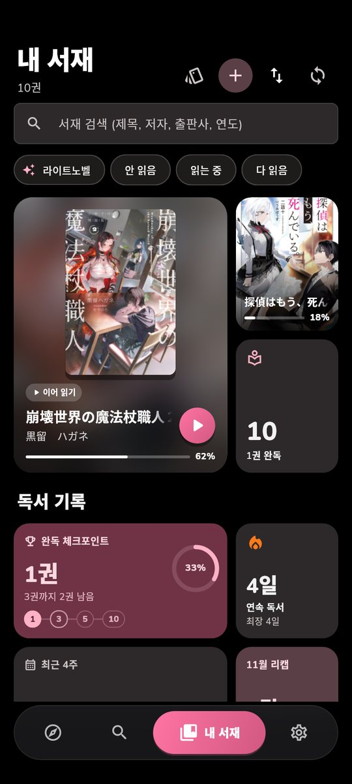](screenshots/library.jpg)
[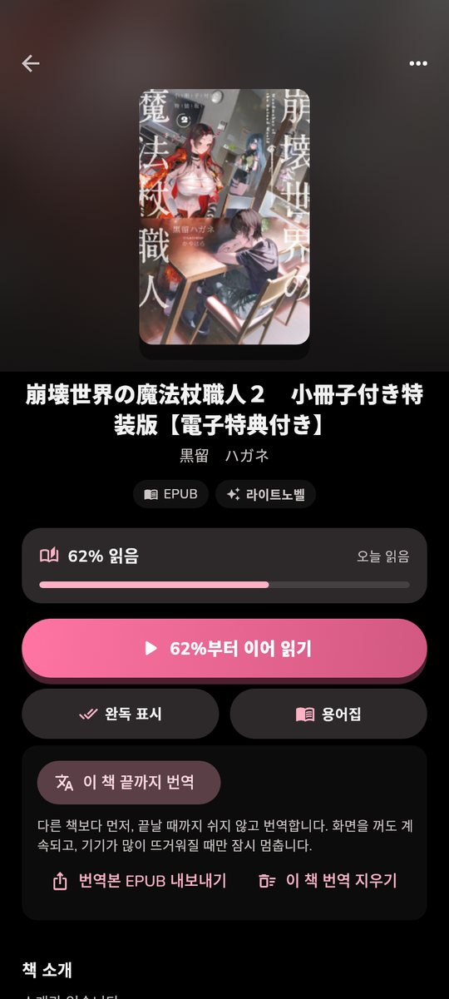](screenshots/book.jpg)
[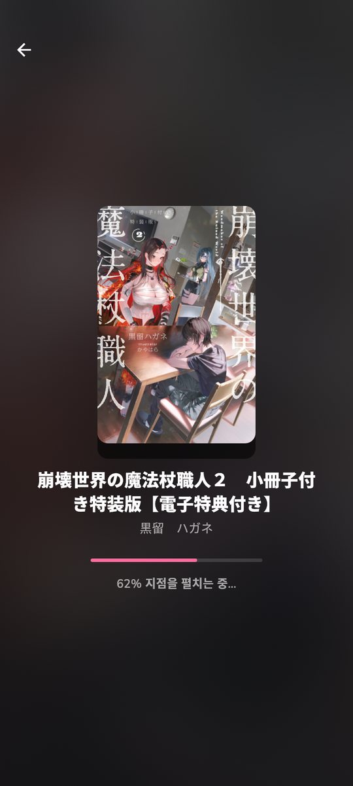](screenshots/opening.jpg)
[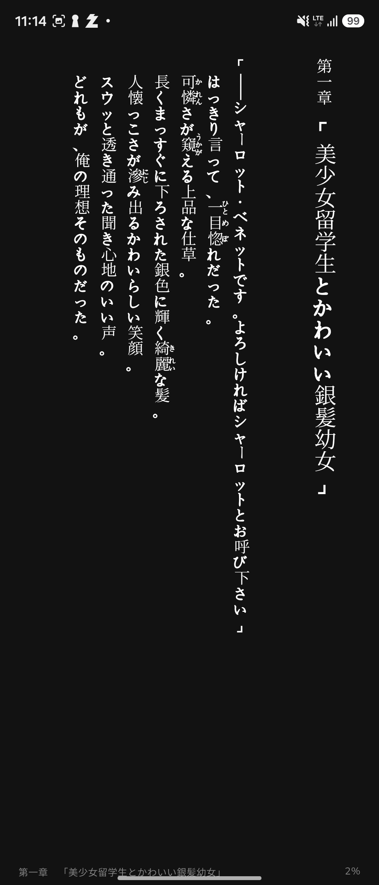](screenshots/reader.jpg)
[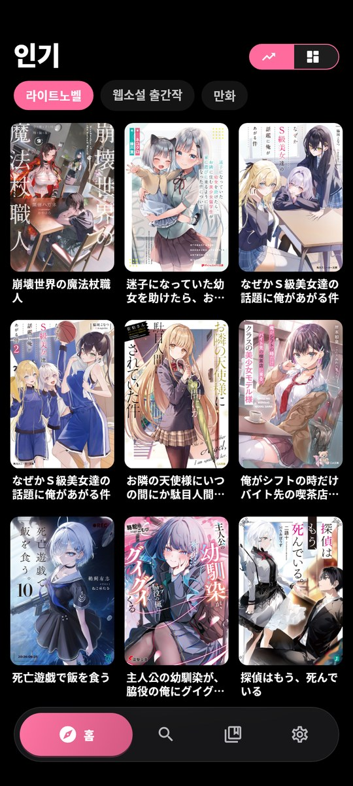](screenshots/home.jpg)
[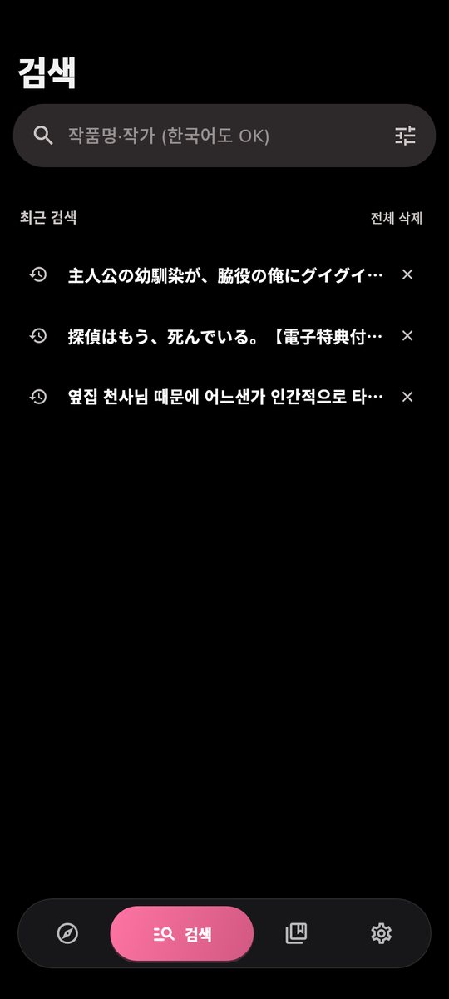](screenshots/search.jpg)
[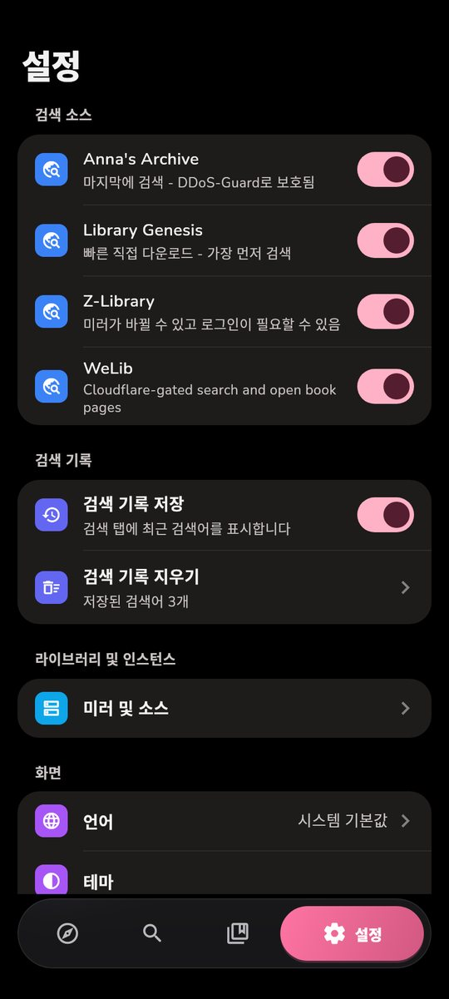](screenshots/settings.jpg)
[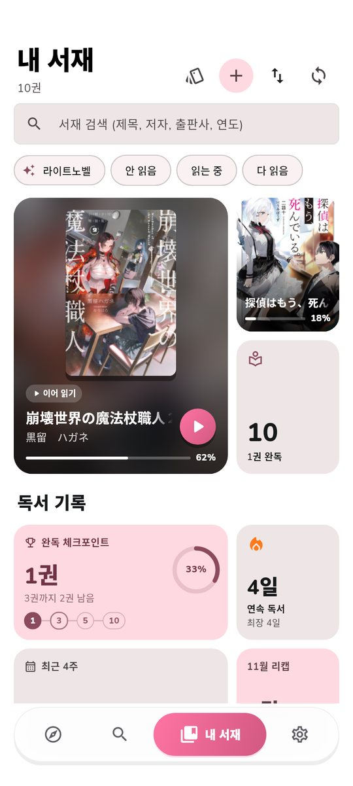](screenshots/library_light.jpg)

**펼친 화면**

[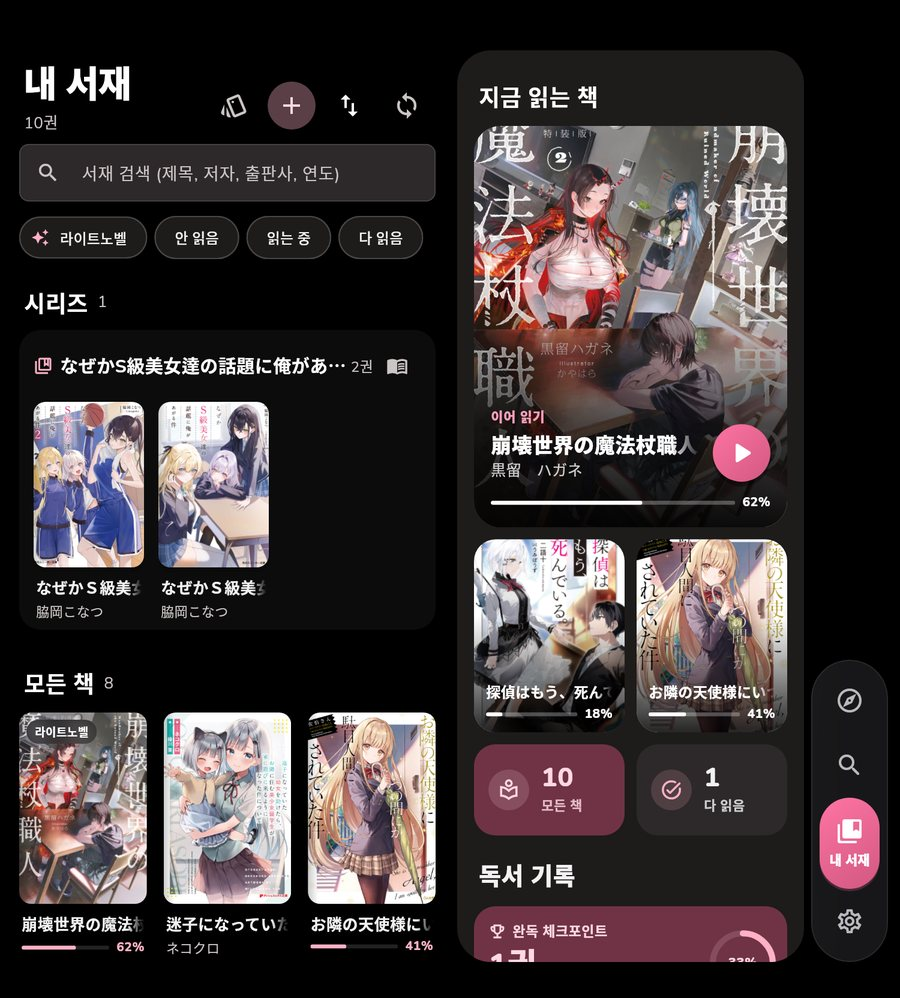](screenshots/fold_library.jpg)
[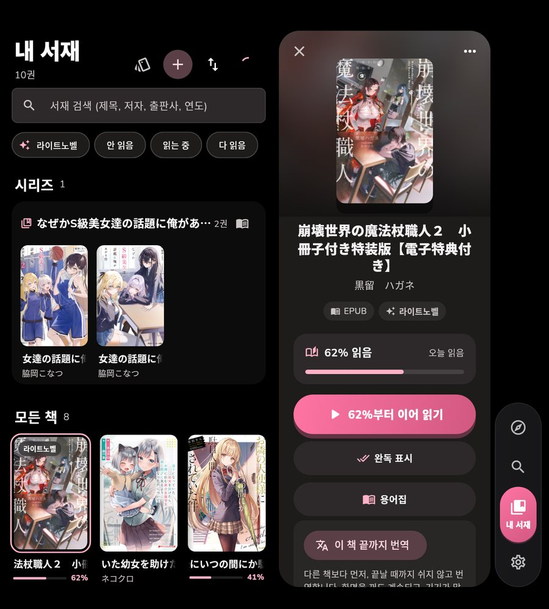](screenshots/fold_book.jpg)
[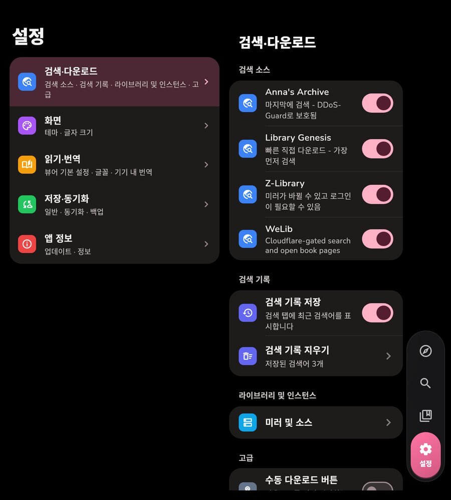](screenshots/fold_settings.jpg)

**웹**

[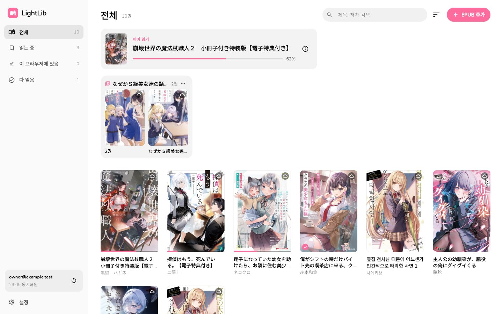](screenshots/web_library.jpg)
[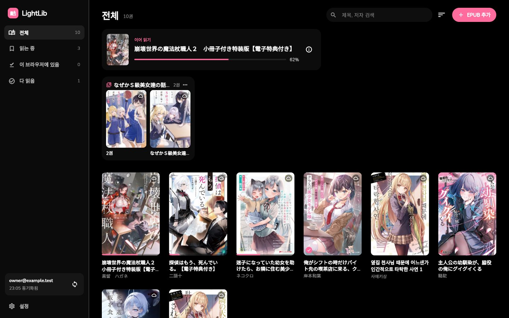](screenshots/web_library_dark.jpg)
[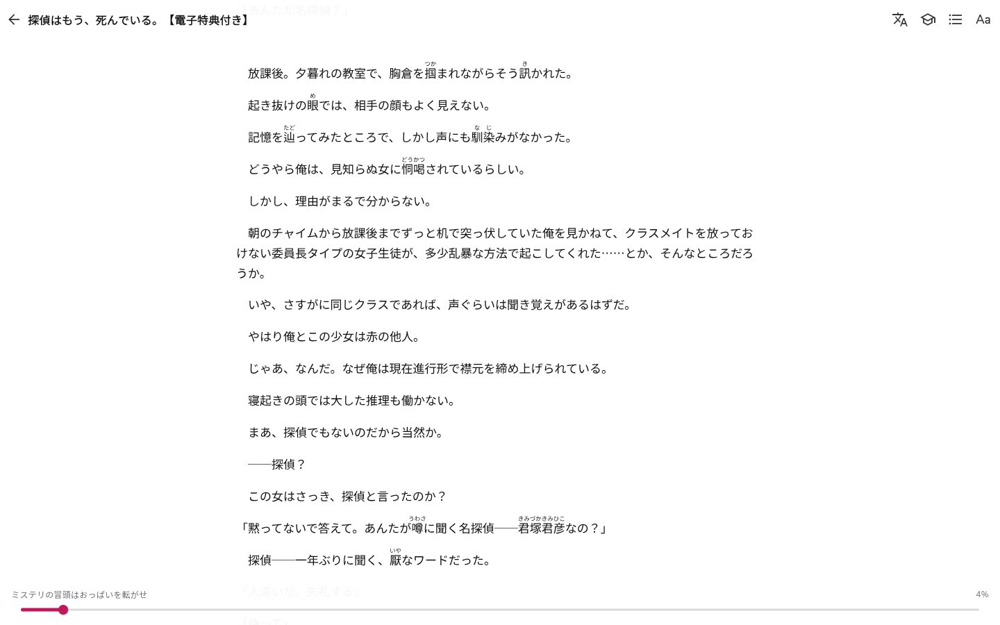](screenshots/web_reader.jpg)

## 설치 📦

[최신 릴리즈](https://github.com/4rNe5/LightLib/releases/latest)에서 `LightLib-<버전>-build.<n>-arm64.apk`를 받아 설치하세요. 릴리즈마다 바뀐 점과 APK의 SHA-256이 적혀 있습니다.

- **안드로이드, arm64** (최근 몇 년 사이의 64비트 휴대폰).
- 모든 릴리즈가 같은 키로 서명되어 새 빌드가 기존 앱 위에 설치되고 서재가 유지됩니다. 처음 설치한 뒤에는 앱에서 업데이트됩니다.
- 휴대폰에서 번역하려면 *설정 → 기기 내 번역*에서 모델(Gemma 4 E2B 또는 E4B)을 받으세요. Gemini나 Claude로 번역하려면 같은 곳에서 엔진을 고르고 키를 넣으면 됩니다.
- 웹과 동기화하려면 *설정 → 동기화*에서 로그인하세요.

## 개발 🛠️

Flutter 3.47 (Dart 3.13).

```bash
git clone https://github.com/4rNe5/LightLib.git
cd LightLib
flutter pub get
flutter run
```

- 리더의 웹 부분은 `reader_web/`에 있고 `assets/reader/`로 빌드됩니다(`reader_web/README.md` 참고).
- 웹 앱: `flutter build web -t lib/main_web.dart`. 마지막 배포 이후 앱이 바뀌었으면 Vercel이 빌드해 배포합니다(`vercel.json`, `tool/vercel_build.sh`, `tool/vercel_ignore.sh`). GitHub Pages(`.github/workflows/web-pages.yml`)와 Cloudflare(`cloudflare/`, `tool/cloudflare_build.sh`)도 `main`에서 같은 앱을 빌드합니다.
- 동기화의 데이터베이스·버킷·접근 규칙은 `supabase/migrations/`에 있습니다.
- `main`에 마크다운 외 변경을 푸시하면 `.github/workflows/android-release.yml`이 테스트·서명된 arm64 빌드·다음 버전(마지막 릴리즈의 패치 + 1, pubspec 버전이 더 높으면 그 버전)의 릴리즈를 만듭니다. `beta`에 푸시하면 같은 과정을 거쳐 다음 버전의 프리릴리즈 `<다음 버전>-beta (build n)`가 나옵니다. `main`으로 가는 PR은 squash가 아니라 merge commit으로 합칩니다.
- 기기 없이 확인하기: `tool/ui_shots/`는 앱 화면을 휴대폰 크기와 펼친 폴더블 크기로, 다크·라이트로 그려 사진으로 남기고, `tool/web_check/`는 빌드한 웹 앱을 headless Chrome에서 실제 클릭으로, 대역 동기화 프로젝트를 상대로 돌립니다(각 README 참고).
- 첫 빌드는 [SETUP.md](SETUP.md), 기여 안내는 [CONTRIBUTING.md](CONTRIBUTING.md)를 보세요.

## 크레딧 🙏

- [Openlib](https://github.com/dstark5/Openlib)(dstark5)과 그 포크 [OpenlibExtended](https://github.com/warreth/OpenlibExtended)(warreth)를 바탕으로 만들었습니다.
- 리더: [foliate-js](https://github.com/johnfactotum/foliate-js) (MIT), [Readest](https://github.com/readest/readest) (AGPL-3.0).
- 동기화: [Supabase](https://supabase.com). 웹 저장소: [sqflite_common_ffi_web](https://pub.dev/packages/sqflite_common_ffi_web)(WebAssembly SQLite), [idb_shim](https://pub.dev/packages/idb_shim).
- 번역: [LiteRT-LM](https://github.com/google-ai-edge/LiteRT-LM), [llamadart](https://pub.dev/packages/llamadart), [Gemma](https://ai.google.dev/gemma) 모델, [Gemini API](https://ai.google.dev/gemini-api), [Claude API](https://docs.claude.com/en/api/overview).
- 용어집과 품질 검사의 접근 방식: [Glossarion](https://github.com/Shirochi-stack/Glossarion) (AGPL-3.0).
- 학습: [kuromoji.js](https://github.com/takuyaa/kuromoji.js) (Apache-2.0)와 mecab-ipadic(NAIST), 한자의 한국어 음은 [KANJIDIC2](http://www.edrdg.org/wiki/index.php/KANJIDIC_Project) (CC BY-SA 4.0, EDRDG), JLPT 단계는 [open-anki-jlpt-decks](https://github.com/jamsinclair/open-anki-jlpt-decks) (MIT).

## 라이선스 📜

[AGPL v3.0](https://www.gnu.org/licenses/agpl-3.0.html).

## 고지 ⚠️

LightLib은 앱에서 볼 수 있는 책을 소유하거나 그와 관련이 있지 않습니다. 모든 책은 각 권리자의 소유이며 저작권법의 보호를 받습니다. LightLib은 앱에서 볼 수 있는 책의 이용으로 생길 수 있는 저작권 등 지식재산권 침해에 책임지지 않습니다. 앱을 사용함으로써 책을 개인적·비상업적 목적으로, 관련 법령을 지키며 이용하는 데 동의하는 것으로 봅니다. 이 앱을 Play 스토어에 올리는 것은 스토어 약관 위반입니다.
