<div align="center">


# LightLib

**An e-book library and reader for Android and the web, made for Japanese light novels: <br/> the book's own layout, translation as you read, and a library that remembers where you are.**

**English** | [한국어](README.ko.md)

[](https://flutter.dev/)
[](https://www.gnu.org/licenses/agpl-3.0.html)
[](https://github.com/4rNe5/LightLib/releases/latest)

[](https://github.com/4rNe5/LightLib/releases/latest)

**[📖 FAQ](./FAQ.md)**
</div>

## Features ✨

### Reading
- **A reader that keeps the book as it was made** — built on [foliate-js](https://github.com/johnfactotum/foliate-js): the book's own layout, images and covers, vertical (縦書き) or horizontal writing, ruby (furigana), paged or scrolled. Fonts, sizes, spacing and themes per script (Korean, Japanese, Latin), styled after [Readest](https://github.com/readest/readest) — set in the reader's *Aa* sheet, or once for every book under *Settings → Reading & translation → Reader defaults*.
- **Opening a book** — the cover you tapped flies into a page of its own, with the title and where you will pick up, until the first page is ready.
- **Where you left off, everywhere** — how far each book is read shows under its cover; a book is marked finished on its last page (or by hand, either way); *Continue reading* is the book you read last, here or on another device; and the home-screen widget shows it with its progress. *Back* from the reader always goes to the book's page, then the library.

### Foldables and tablets
- **Two panes, split at the fold** — from 600 dp wide (an unfolded Galaxy Z Fold, a tablet, a phone on its side) the library sits beside what you are reading and your reading record, and a book you tap opens in the pane beside the shelf; settings show their categories beside the chosen one; search keeps its filters open beside the field. Fold the phone with a book open and you are on its page; unfold it and the page steps back into the pane.
- **Tabs in the corner** — on a wide screen the tab bar stands on end in the lower right, out of the way of the fold and within reach of the thumb.
- **Two pages side by side** — horizontal books turned page by page show two pages on an unfolded screen (*Two pages side by side*, on by default).
- **Motion that says what happened** — covers that give under the finger and fly between screens, tiles that come in one after another, numbers that count up; all of it stands still with the system's *Remove animations*.

### Translation
- **Translation as you read** — open a Japanese book and read it in Korean (or another of 14 languages), paragraph by paragraph, in a light-novel style tuned for Korean: past-tense narration, each character's own 존댓말 or 반말, names as the book reads them.
- **Three engines, one translation** — translate on the phone with Gemma 4 ([LiteRT-LM](https://github.com/google-ai-edge/LiteRT-LM) on the GPU, or GGUF models through llama.cpp via [llamadart](https://pub.dev/packages/llamadart)), or with **Google Gemini** or **Anthropic Claude** for whole books in minutes. All of them write to the same saved translation, so you can switch at any time and pick up where the other left off.
- **A glossary per book, and per series** — characters, genders, places and terms are gathered once from the book's own text and ruby, kept the same on every page and shared between the volumes of a series. Open it from the book's page or the series without opening the book; set a name right and the paragraphs that used the old one are translated again — in this book or the whole series.
- **Checked before you see it** — translations that leave Japanese behind, repeat themselves, drop sentences, get a name wrong or lose a speaker's politeness are sent back once with the problem named; the better version stays.
- **Translate a whole book** — one tap on the book's page puts it first and runs it to the end, at full speed while the app is open and gently in the background, so it is ready when you sit down to read.
- **Background translation** — optionally, the rest of the library is translated a little at a time, slowing down as the phone warms up and pausing for a low battery, with progress in the notification shade.
- **Translated EPUB** — export any book with its translation as a regular EPUB, horizontal and in the target language, to keep or open in another reading app.

### Learning Japanese while you read
- **Side by side** — the translation under each paragraph, or hidden under it until you tap, with the book left in Japanese.
- **Words in their sentence** — tap a word (or long-press any text) for its dictionary form, reading, JLPT level, the kanji's Korean readings, and its meaning *in that sentence*, from the engine you translate with.
- **Sentences explained** — a translation, the words and grammar a reader at your level may not know, and the nuance.
- **Furigana** — over every kanji word, or only over those above your level.
- **A word book** — words you add keep their sentence and book, come back for review the way Anki schedules them, and export to Anki.
- **How hard is this book?** — its words by JLPT level, the share above yours, and the words above your level it uses most, ready to add.
- **A study record** — words looked up, sentences explained, cards reviewed, characters read in the original, and the streak.

### Gemini or Claude, if you want them
- **Gemini** — add your own key from [Google AI Studio](https://aistudio.google.com/apikey) (the free tier covers several books a day) and choose a model. The settings show today's use against your limits, with the reset time and the cost at paid prices; let you choose how much the model thinks (speed, balance or quality); and set the content filters, which are off by default so books rated 15+ and adult read in full.
- **Claude** — add a key from the [Claude Console](https://platform.claude.com/settings/keys) and choose Haiku, Sonnet or Opus; the settings show what today's translating cost, model by model. In our blind comparisons on light novels Sonnet read best, and Haiku about as well as Gemini Flash at a fraction of its price.
- When the day's quota runs out or a paragraph cannot be done, the phone's model carries on.

### Library
- **Your books, at a glance** — full-quality covers from the books themselves, how far each is read, tags and genres, search and filters, and a reading record: checkpoints, streaks, four weeks of activity, the month and your genre mix.
- **Series** — choose volumes with a long press and group them; a series is one row in the library, its volumes in order, and the grouping follows you to your other devices and the web.
- **Hide a cover** — for any book, on the library, the book's page and the widgets.
- **Discover** — what sells on BOOK☆WALKER now (light novels, web novels in print, manga, and their genres), and popular English titles.
- **Home-screen widgets** — *Continue reading* (with the book's progress) and *Reading record*, laid out for every size from 1×1 up, folded or unfolded.

### On the web, in sync
- **The same reader in the browser** — the library, the reader (vertical writing, ruby, themes) and translation by Gemini or Claude, as a web app (`lib/main_web.dart`). Add EPUB files from the computer (the button, or drop them on the window); they stay in the browser's own storage. *Translate this whole book* is on a book's card too, and runs while the tab is open.
- **Made for a desktop window, too** — a side bar (all, reading, on this browser, finished), search (`/`), sorting, the last book to pick up again, a right-click menu on every book, settings in a dialog; the series packed into cards that fill each row, so many fit on one screen; in the reader a readable column when scrolling and two pages side by side when turning, with the arrow keys, Page Up/Down, Space and the mouse wheel. A phone's browser gets the same library under an app bar. Light and dark follow the system.
- **The whole library at once, files when you read** — signed in, the web lists every book of the account from its title, author and cover, without downloading any (a book that has no small cover yet has just its cover read out of the file). A book's card (cover, details, how far you are, what is translated) has the button that opens it; only then is that one file fetched, with its progress shown. A book's copy can be removed from the browser while it stays in the account. When you come back from a book, the library already shows where you left it.
- **Phone and web in sync** — sign in with Google (*Settings → Sync*) and your books (EPUB files), reading positions, translations, glossaries and series follow you: open a book on the phone, carry on in the browser on the same page, with everything either side has translated and the same names. Positions and glossaries keep the newest, translations merge, and a book deleted on one side goes on the other. A book that arrives brings its translations with it; an open book fetches the other side's first, and saved translations show even where no engine is set up. The Gemini and Claude keys are shared too (the newest wins; *Settings → Sync* turns either off and removes the copy the project holds). Progress and results show as a notification on the phone.
- **More than one address** — the web app is served by Vercel, and also from GitHub Pages and a Cloudflare Worker that passes sync on through its own address, for networks that block one of them.
- **Your own project** — sync runs on a [Supabase](https://supabase.com) project that only the accounts it lists can read or write. To run your own, apply `supabase/migrations/` to a project of yours and point `SyncConfig` (`lib/services/sync/sync_service.dart`) at it.

### And
- **Updates from this repository** — the app checks the latest release, downloads it over Wi-Fi (verified against its SHA-256), shows what changed, and installs with one tap. *Include Beta Updates* in the settings offers the pre-releases too.
- **Six languages** — English, 한국어, 日本語, Deutsch, Español, Français.

## Your data 🔒

Your library, reading positions, glossaries and translations stay on your phone (and in your backups) — or, on the web, in the browser. If you sign in to sync, your books, reading positions, translations, glossaries and series are also kept in the sync project, readable only by its listed accounts; so are the Gemini and Claude keys, unless you turn their sharing off in *Settings → Sync*. Translating on the phone keeps everything there too. The study features ask the same engine, so with Gemini or Claude the word or sentence you look up goes along the same way. The Japanese word tools (about 18 MB) come once from a public package mirror (jsDelivr, or unpkg) the first time you turn on furigana or word taps. When you choose Gemini, the paragraphs being translated go to Google with your own key, and with Claude to Anthropic, the same way any app using them works; on Google's free tier they may be used to improve Google's services, and on a paid key they are not. The keys themselves are never part of a backup.

## Screenshots 🖼️

**Phone**

[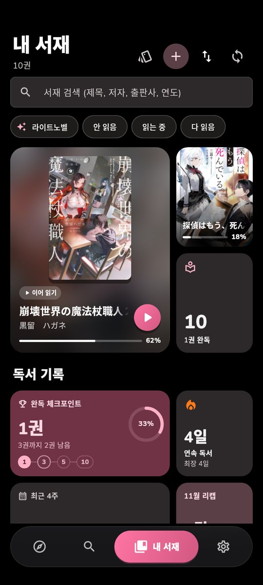](screenshots/library.jpg)
[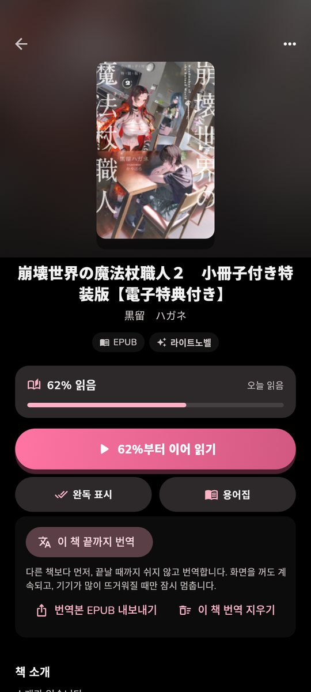](screenshots/book.jpg)
[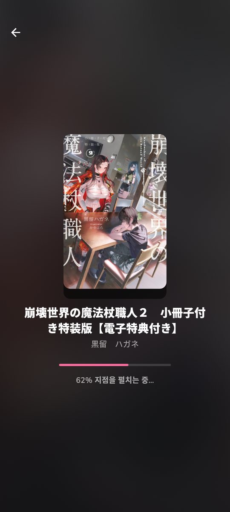](screenshots/opening.jpg)
[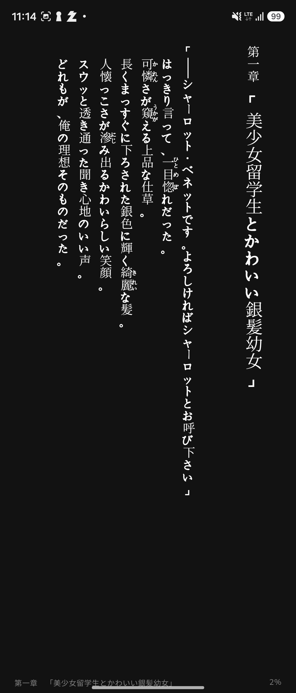](screenshots/reader.jpg)
[](screenshots/home.jpg)
[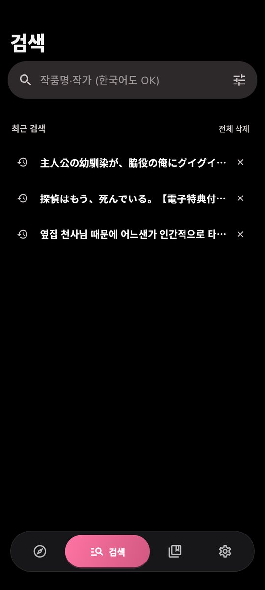](screenshots/search.jpg)
[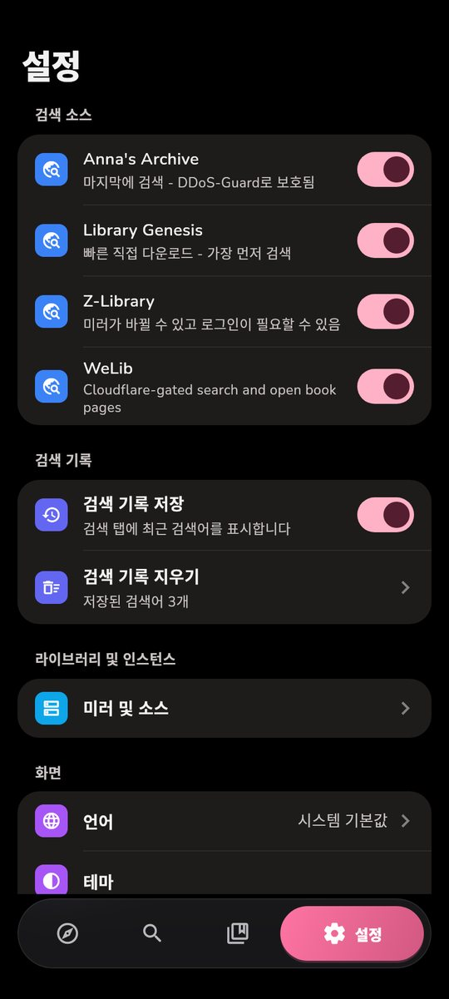](screenshots/settings.jpg)
[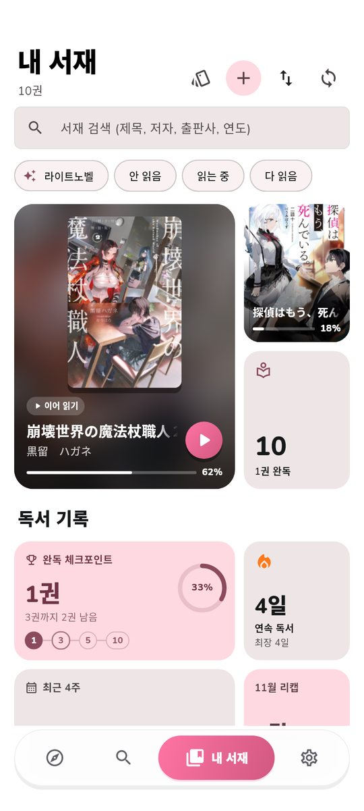](screenshots/library_light.jpg)

**Unfolded**

[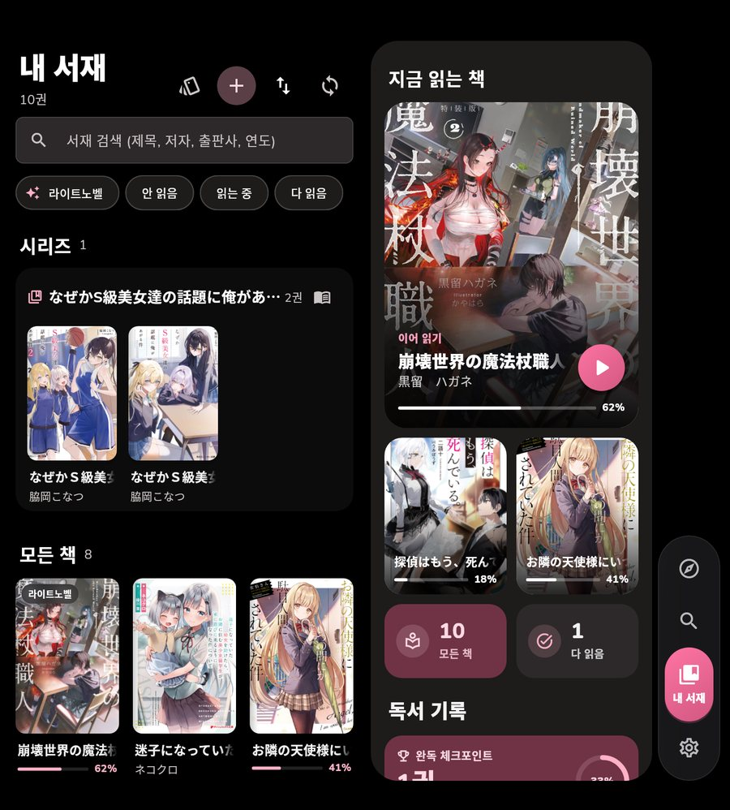](screenshots/fold_library.jpg)
[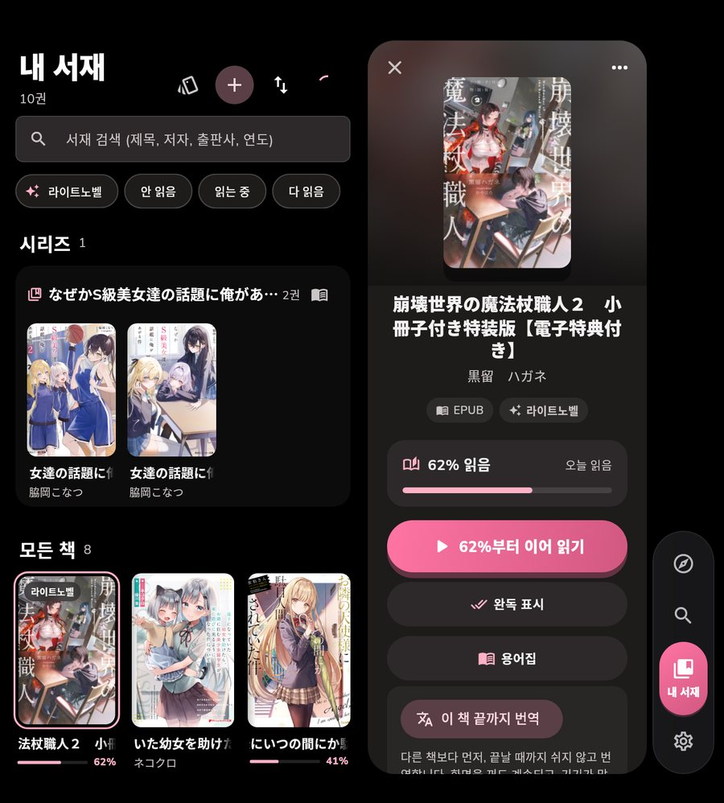](screenshots/fold_book.jpg)
[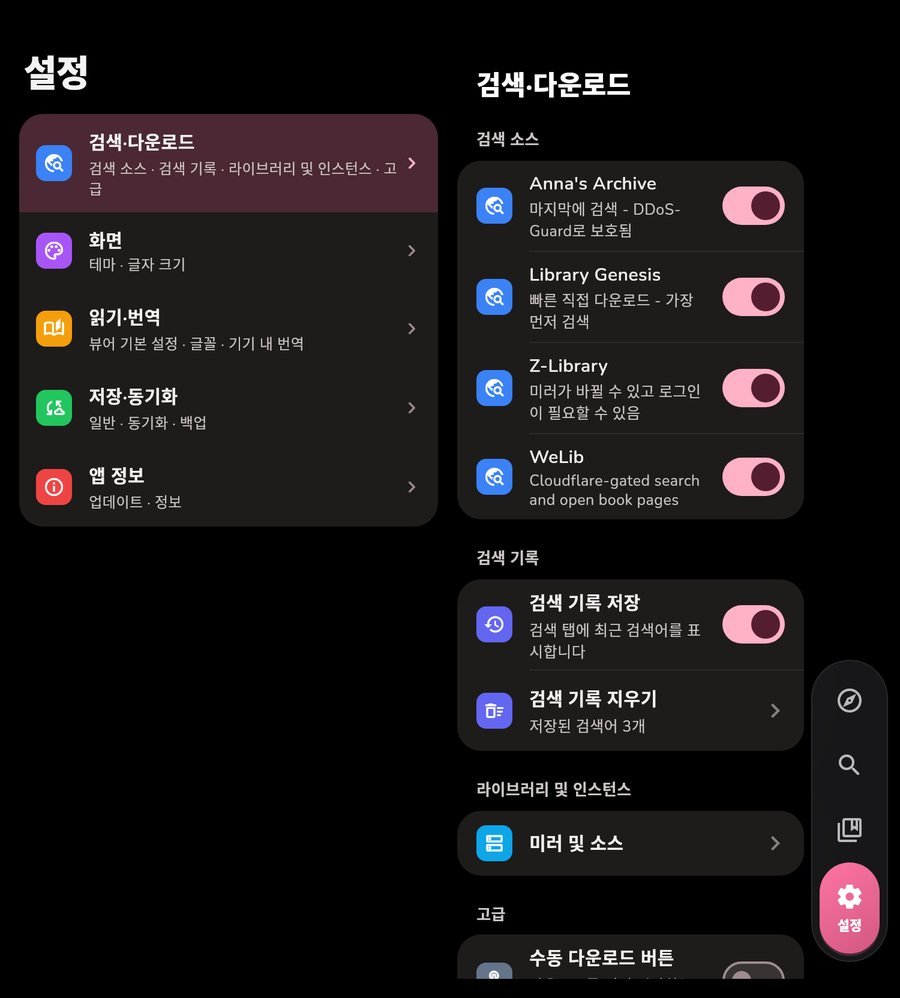](screenshots/fold_settings.jpg)

**Web**

[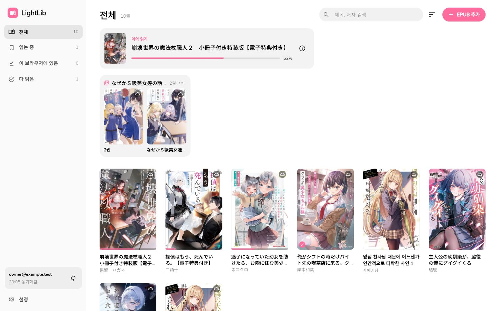](screenshots/web_library.jpg)
[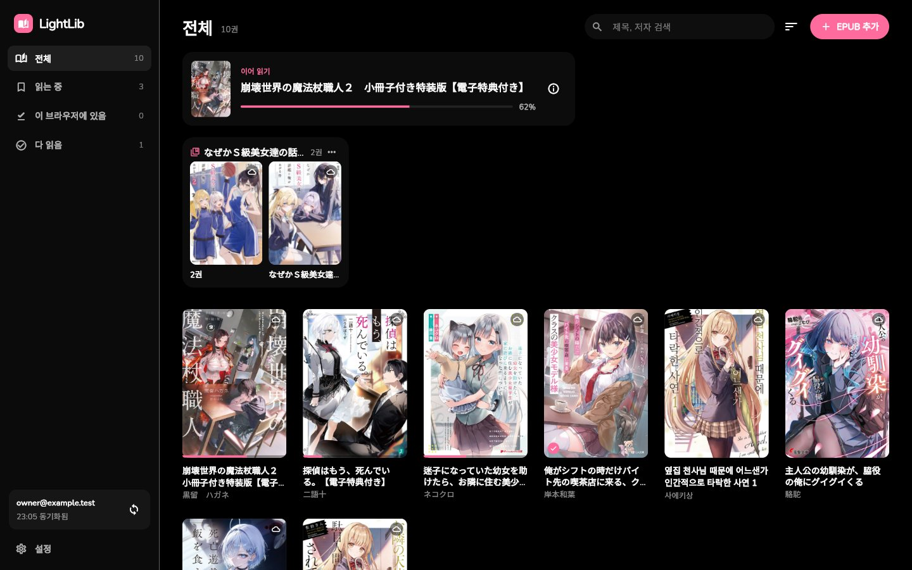](screenshots/web_library_dark.jpg)
[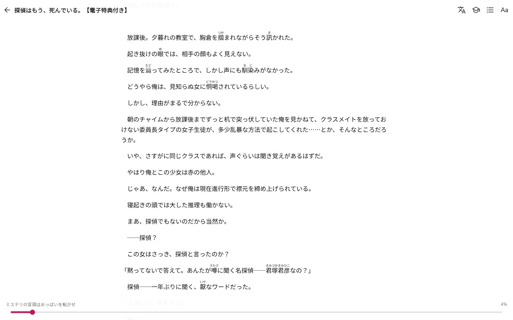](screenshots/web_reader.jpg)

## Installation 📦

Download `LightLib-<version>-build.<n>-arm64.apk` from the [latest release](https://github.com/4rNe5/LightLib/releases/latest) and install it. Each release lists its changes and the APK's SHA-256.

- **Android, arm64** (64-bit phones from the last several years).
- Every release is signed with the same key, so a new build installs over the old one and keeps your library. After the first install, updates come through the app.
- To translate on the phone, download a model in *Settings → On-device translation* (Gemma 4 E2B or E4B). To translate with Gemini or Claude, choose the engine and add its key in the same place.
- To sync with the web, sign in under *Settings → Sync*.

## Development 🛠️

Flutter 3.47 (Dart 3.13).

```bash
git clone https://github.com/4rNe5/LightLib.git
cd LightLib
flutter pub get
flutter run
```

- The reader's web part lives in `reader_web/` and is bundled into `assets/reader/` (see `reader_web/README.md`).
- The web app: `flutter build web -t lib/main_web.dart`. Vercel builds and serves it whenever the app changed since its last deployment (`vercel.json`, `tool/vercel_build.sh`, `tool/vercel_ignore.sh`); GitHub Pages (`.github/workflows/web-pages.yml`) and Cloudflare (`cloudflare/`, `tool/cloudflare_build.sh`) build the same app from `main`.
- Sync's database, bucket and access rules are in `supabase/migrations/`.
- Every push to `main` that changes more than Markdown runs `.github/workflows/android-release.yml`: tests, a signed arm64 build, and a release with the next version number (the last one's patch + 1, or pubspec's version when that is higher). A push to `beta` does the same as a pre-release of the version to come, `<next>-beta (build n)`. Pull requests into `main` are merged with a merge commit, not squashed.
- Checks without a device: `tool/ui_shots/` draws the app's screens at a phone's size and an unfolded foldable's, in dark or light; `tool/web_check/` runs the built web app in headless Chrome with real clicks against a stand-in sync project (see their READMEs).
- [SETUP.md](SETUP.md) walks through a first build; [CONTRIBUTING.md](CONTRIBUTING.md) has the guidelines.

## Credits 🙏

- Built on [Openlib](https://github.com/dstark5/Openlib) by dstark5 and its fork [OpenlibExtended](https://github.com/warreth/OpenlibExtended) by warreth.
- [foliate-js](https://github.com/johnfactotum/foliate-js) (MIT) and [Readest](https://github.com/readest/readest) (AGPL-3.0) for the reader.
- [Supabase](https://supabase.com) for sync, and [sqflite_common_ffi_web](https://pub.dev/packages/sqflite_common_ffi_web) (SQLite in WebAssembly) and [idb_shim](https://pub.dev/packages/idb_shim) for the web's storage.
- [LiteRT-LM](https://github.com/google-ai-edge/LiteRT-LM), [llamadart](https://pub.dev/packages/llamadart), the [Gemma](https://ai.google.dev/gemma) models, the [Gemini API](https://ai.google.dev/gemini-api) and the [Claude API](https://docs.claude.com/en/api/overview) for translation.
- [Glossarion](https://github.com/Shirochi-stack/Glossarion) (AGPL-3.0) for the approach of the glossary and quality checks.
- For study: [kuromoji.js](https://github.com/takuyaa/kuromoji.js) (Apache-2.0) with mecab-ipadic (NAIST), [KANJIDIC2](http://www.edrdg.org/wiki/index.php/KANJIDIC_Project) (CC BY-SA 4.0, EDRDG) for the Korean readings of kanji, and [open-anki-jlpt-decks](https://github.com/jamsinclair/open-anki-jlpt-decks) (MIT) for JLPT levels.

## License 📜

[AGPL v3.0](https://www.gnu.org/licenses/agpl-3.0.html).

## Disclaimer ⚠️

LightLib does not own or have any affiliation with the books available through the app. All books are the property of their respective owners and are protected by copyright law. LightLib is not responsible for any infringement of copyright or other intellectual property rights that may result from the use of the books available through the app. By using the app, you agree to use the books only for personal, non-commercial purposes and in compliance with all applicable laws and regulations. Publishing this app to the Play Store violates its terms.
