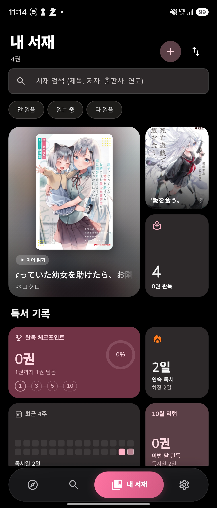
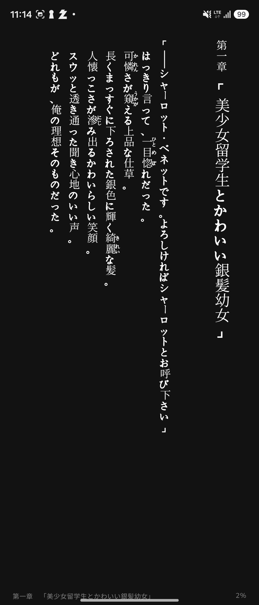
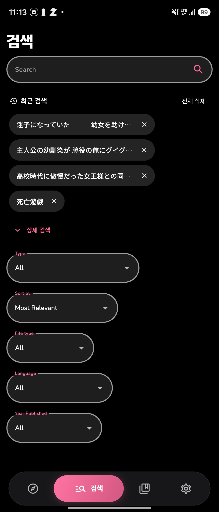
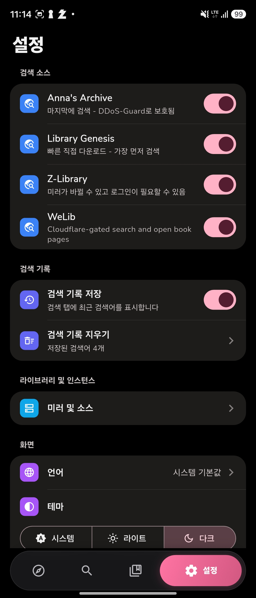

<div align="center">


# LightLib

**An e-book library and reader for Android, made for Japanese light novels: <br/> the book's own layout, translation as you read, and a library that remembers where you are.**

**English** | [한국어](README.ko.md)

[](https://flutter.dev/)
[](https://www.gnu.org/licenses/agpl-3.0.html)
[](https://github.com/4rNe5/LightLib/releases/latest)

[](https://github.com/4rNe5/LightLib/releases/latest)

**[📖 FAQ](./FAQ.md)**
</div>

## Features ✨

### Reading
- **A reader that keeps the book as it was made** — built on [foliate-js](https://github.com/johnfactotum/foliate-js): the book's own layout, images and covers, vertical (縦書き) or horizontal writing, ruby (furigana), paged or scrolled. Fonts, sizes, spacing and themes per script (Korean, Japanese, Latin), styled after [Readest](https://github.com/readest/readest).
- **Foldables and tablets** — cover grids add columns as the screen widens, and the tab bar stays phone-sized on an unfolded screen.

### Translation
- **Translation as you read** — open a Japanese book and read it in Korean (or another of 14 languages), paragraph by paragraph, in a light-novel style tuned for Korean: past-tense narration, each character's own 존댓말 or 반말, names as the book reads them.
- **Two engines, one translation** — translate on the phone with Gemma 4 ([LiteRT-LM](https://github.com/google-ai-edge/LiteRT-LM) on the GPU, or GGUF models through llama.cpp via [llamadart](https://pub.dev/packages/llamadart)), or with **Google Gemini** for whole books in minutes. Both write to the same saved translation, so you can switch at any time and pick up where the other left off.
- **A glossary per book** — characters, genders, places and terms are gathered once from the book's own text and ruby, editable, and kept the same on every page.
- **Checked before you see it** — translations that leave Japanese behind, repeat themselves, drop sentences, get a name wrong or lose a speaker's politeness are sent back once with the problem named; the better version stays.
- **Translate a whole book** — one tap on the book's page puts it first and runs it to the end, at full speed while the app is open and gently in the background, so it is ready when you sit down to read.
- **Background translation** — optionally, the rest of the library is translated a little at a time, slowing down as the phone warms up and pausing for a low battery, with progress in the notification shade.
- **Translated EPUB** — export any book with its translation as a regular EPUB, horizontal and in the target language, to keep or open in another reading app.

### Gemini, if you want it
Add your own key from [Google AI Studio](https://aistudio.google.com/apikey) (the free tier covers several books a day) and choose a model. The settings show today's use against your limits, with the reset time and the cost at paid prices; let you choose how much the model thinks (speed, balance or quality); and set the content filters, which are off by default so books rated 15+ and adult read in full. When the day's quota runs out or a paragraph cannot be done, the phone's model carries on.

### Library
- **Your books, at a glance** — full-quality covers from the books themselves, reading status, tags and genres, search and filters, and a reading record: checkpoints, streaks, four weeks of activity, the month and your genre mix.
- **Hide a cover** — for any book, on the library, the book's page and the widgets.
- **Discover** — what sells on BOOK☆WALKER now (light novels, web novels in print, manga, and their genres), and popular English titles.
- **Home-screen widgets** — *Continue reading* and *Reading record*, laid out for every size from 1×1 up, folded or unfolded.

### And
- **Updates from this repository** — the app checks the latest release, downloads it over Wi-Fi (verified against its SHA-256), shows what changed, and installs with one tap.
- **Six languages** — English, 한국어, 日本語, Deutsch, Español, Français.

## Your data 🔒

Your library, reading positions, glossaries and translations stay on your phone (and in your backups). Translating on the phone keeps everything there too. When you choose Gemini, the paragraphs being translated go to Google with your own key, the same way any app using Gemini works; on Google's free tier they may be used to improve Google's services, and on a paid key they are not. The key itself is kept on the device only and is never part of a backup.

## Screenshots 🖼️

[](screenshots/library.jpg)
[](screenshots/reader.jpg)
[](screenshots/search.jpg)
[](screenshots/settings.jpg)

## Installation 📦

Download `LightLib-<version>-build.<n>-arm64.apk` from the [latest release](https://github.com/4rNe5/LightLib/releases/latest) and install it. Each release lists its changes and the APK's SHA-256.

- **Android, arm64** (64-bit phones from the last several years).
- Every release is signed with the same key, so a new build installs over the old one and keeps your library. After the first install, updates come through the app.
- To translate on the phone, download a model in *Settings → On-device translation* (Gemma 4 E2B or E4B). To translate with Gemini, add a key in the same place.

## Development 🛠️

Flutter 3.47 (Dart 3.13).

```bash
git clone https://github.com/4rNe5/LightLib.git
cd LightLib
flutter pub get
flutter run
```

- The reader's web part lives in `reader_web/` and is bundled into `assets/reader/` (see `reader_web/README.md`).
- Every push to `main` that changes more than Markdown runs `.github/workflows/android-release.yml`: tests, a signed arm64 build, and a release tagged `v<version>-build.<n>`.
- [SETUP.md](SETUP.md) walks through a first build; [CONTRIBUTING.md](CONTRIBUTING.md) has the guidelines.

## Credits 🙏

- Built on [Openlib](https://github.com/dstark5/Openlib) by dstark5 and its fork [OpenlibExtended](https://github.com/warreth/OpenlibExtended) by warreth.
- [foliate-js](https://github.com/johnfactotum/foliate-js) (MIT) and [Readest](https://github.com/readest/readest) (AGPL-3.0) for the reader.
- [LiteRT-LM](https://github.com/google-ai-edge/LiteRT-LM), [llamadart](https://pub.dev/packages/llamadart), the [Gemma](https://ai.google.dev/gemma) models and the [Gemini API](https://ai.google.dev/gemini-api) for translation.
- [Glossarion](https://github.com/Shirochi-stack/Glossarion) (AGPL-3.0) for the approach of the glossary and quality checks.

## License 📜

[AGPL v3.0](https://www.gnu.org/licenses/agpl-3.0.html).

## Disclaimer ⚠️

LightLib does not own or have any affiliation with the books available through the app. All books are the property of their respective owners and are protected by copyright law. LightLib is not responsible for any infringement of copyright or other intellectual property rights that may result from the use of the books available through the app. By using the app, you agree to use the books only for personal, non-commercial purposes and in compliance with all applicable laws and regulations. Publishing this app to the Play Store violates its terms.
